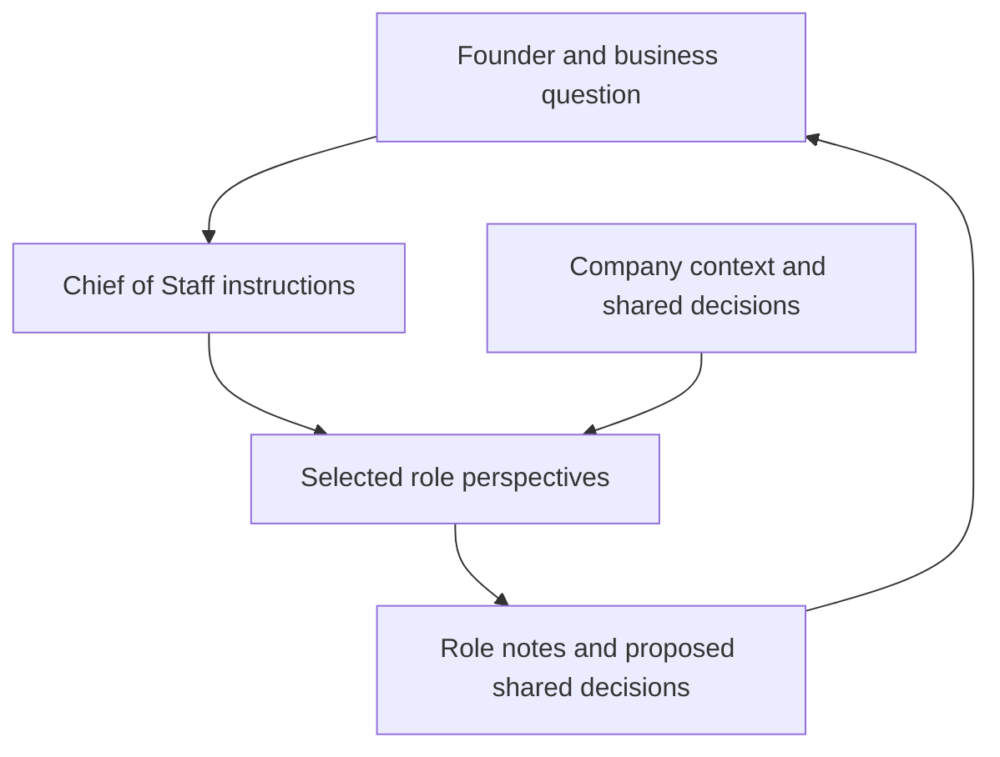

# Auto C-Suite

A role-based AI advisory workspace for solo founders: explore a business question
with distinct finance, technology, legal, operations, marketing, and revenue perspectives.
It uses Markdown instructions and persistent local files with Claude Code or Gemini CLI.

**Status:** experimental prompt and workflow framework. The roles guide model behavior;
they do not turn a language model into a qualified executive or guarantee independent reasoning.

## Why build this?

Founders need to connect product decisions to pricing, delivery, risk, and customer
acquisition. This project explores whether explicit roles, shared decisions, and
persistent context make those conversations more useful than repeatedly starting
from a blank prompt.

## Quick start

Install and authenticate Claude Code or Gemini CLI using the provider's instructions.
The shell setup requires Bash; use Linux, macOS, or WSL.

```bash
git clone https://github.com/peterthelander/auto-c-suite.git
cd auto-c-suite
bash setup.sh
claude  # or: gemini
```

In the CLI session, start the founding interview:

```text
/interview
```

The interview is intended to populate `COMPANY_CONTEXT.md`. CLI-specific commands
and instruction loading depend on your CLI version; inspect [CLAUDE.md](CLAUDE.md),
[GEMINI.md](GEMINI.md), and the corresponding agent files for the protocol.
Model access, authentication, and any provider charges are configured separately.

## Roles and coordination

| Role | Perspective |
| --- | --- |
| Chief of Staff | Founding interview, priorities, coordination, and shared decisions |
| CFO | Pricing, unit economics, runway, and budgets |
| Legal | Questions about structure, contracts, and compliance for further review |
| CMO | Positioning, channels, and early customers |
| CTO | Technical choices, architecture, and implementation risks |
| COO | Delivery, process, and scaling operations |
| CRO | B2B pipeline, sales process, and revenue |

The founding interview proposes a starting board; `/hire @agent` describes adding
roles as needs change. These are agent instructions and conventions, not a separate
scheduler or independently enforced organizational structure.



## Example conversation

```text
@cto @cfo I'm deciding between a managed database and a self-hosted one.
What are the costs, operational risks, and assumptions we should test first?
```

For a broader review:

```text
Go around the active board and identify one priority, one risk, and one
assumption to validate before the next release.
```

These are example prompts, not measured outcomes. Quality depends on the model,
context, and human review. Legal and financial outputs need appropriate verification.

## Memory and data flow

The instructions use three kinds of persistent context:

- `COMPANY_CONTEXT.md`: shared business context.
- Role-owned logs: notes for each advisory perspective.
- `corporate_decisions.md`: shared decisions distilled for cross-functional context.

Setup creates local records under `.claude/memory/` and `.gemini/memory/`.
Private company context and memory files are ignored by Git by default. **Git exclusion
is not a guarantee that data remains on the machine:** the CLI may send the files it
reads to its configured model provider. Review provider settings and avoid sensitive
business details unless that processing is appropriate. Local inference, if configured,
has its own operational and data-handling considerations.

## Scope and next steps

The repository includes a founding interview, role instructions, shared-memory
conventions, setup script, and status prompts. Workspace integrations, broader
industry profiles, and further automated coordination remain exploratory.
There is no claim that multiple role prompts produce independent expert judgment.

## License

GNU General Public License v3.0. See [LICENSE](LICENSE).
